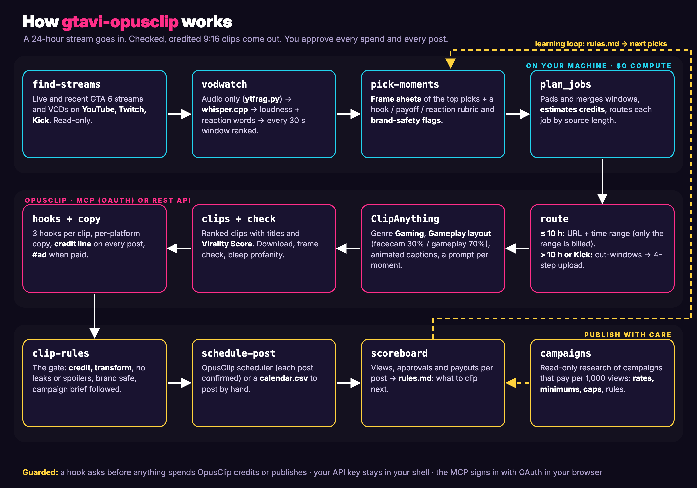

<div align="center">


# gtavi-opusclip

<table><tr><td align="center">
<h3>The streamers made the moments.<br>OpusClip makes the clips.</h3>
</td></tr></table>

GTA 6 just broke the streaming record for a game launch: 7.91M people watching at once, per Streams Charts. Nobody is going to sit through 23 hours of VOD. This Claude Code plugin watches the whole stream on your machine, finds the seconds the streamer lost it, and has OpusClip turn them into captioned 9:16 clips with a Virality Score. Campaigns pay per 1,000 views. You check, credit and post.

   
<br>
 

<br><br>


[Quick start](#quick-start) · [Make money](#make-money) · [Skills](#skills) · [Clip rules](#clip-rules) · [Scripts](#scripts)

</div>

---

## Quick start

**1. Install the plugin.** In Claude Code:

```text
/plugin marketplace add [OWNER]/gtavi-opusclip
/plugin install gtavi-opusclip@gtavi-opusclip
```

**2. Connect OpusClip.** Either way works for links up to 10 h. GTA 6 launch VODs are longer, so their windows are cut locally (`cut_windows.py`) and uploaded: `opusclip_api.py batch` does the upload for you, or use `opusclip_create_upload_link` over MCP.

- **MCP (interactive).** The plugin bundles OpusClip's hosted MCP server, `https://mcp.opus.pro/mcp`. Run `/mcp`, pick `opusclip` and authenticate; you sign in on OpusClip's own OAuth page in your browser. OpusClip MCP tool calls need a Pro (Beta), Max or Business plan.
- **REST API (scripts and automation).** Create a key at [clip.opus.pro/dashboard](https://clip.opus.pro/dashboard) → API Access → Create key, then export it in your shell. Never commit it.

  ```bash
  export OPUSCLIP_API_KEY=...
  ```

- *Optional:* add OpusClip's official plugin for its own CLI skill:

  ```text
  /plugin marketplace add opus-pro/opus-skills
  /plugin install opusclip@opus-skills
  ```

**3. Local tools** (for scanning whole VODs on your machine):

```bash
brew install ffmpeg yt-dlp whisper-cpp
mkdir -p ~/.cache/whisper.cpp && curl -L -o ~/.cache/whisper.cpp/ggml-large-v3-turbo-q5_0.bin \
  https://huggingface.co/ggerganov/whisper.cpp/resolve/main/ggml-large-v3-turbo-q5_0.bin
```

Then run `/gtavi-opusclip:setup` to check everything and create the `gtavi/` work folder.

**4. Clip a stream.**

```text
/gtavi-opusclip:clip-desk https://www.youtube.com/watch?v=<VOD_ID> 8
```

Or go step by step:
- `/gtavi-opusclip:find-streams kai cenat`
- `/gtavi-opusclip:vodwatch <vod> 8`
- `/gtavi-opusclip:pick-moments`
- `/gtavi-opusclip:opusclip-clip`

Claude stops for your yes before it spends credits, and before every post.

<details><summary>No Claude Code? The scripts run on their own.</summary>

```bash
python3 -I scripts/vodwatch.py run "https://www.youtube.com/watch?v=<VOD_ID>" --clips 8 --out scans/speed
python3 -I scripts/cut_windows.py --plan scans/speed/plan.json   # only when plan.json routes "upload" (over 10 h, Kick, local files)
python3 -I scripts/opusclip_api.py --dry-run batch scans/speed/plan.json     # see the exact requests
python3 -I scripts/opusclip_api.py batch scans/speed/plan.json --yes --wait  # spends credits
python3 -I scripts/opusclip_api.py clips <projectId> --top 10 --plan scans/speed/plan.json   # times in the stream
python3 -I scripts/opusclip_api.py download <projectId> --top 5 --out clips/ --plan scans/speed/plan.json
```
</details>

## How it works



1. **Find.** `find-streams` lists live and recent GTA 6 streams and VODs: YouTube search, plus each watchlisted channel's YouTube streams and Twitch archives (Kick channels come back as links to open). It is read-only.
2. **Watch the whole VOD, locally.** `vodwatch` downloads only the audio and transcribes it with whisper.cpp. Then it scores every 30-second window on:
   - loudness spikes against the 20 minutes around it,
   - sudden jumps,
   - reaction words ("no way", "oh my god", screams, laughter),
   - talking speed.

   Your machine does the work, so compute is free. Before every download it asks yt-dlp how YouTube serves the VOD. Right after a stream that is often 2-second fragments that `yt-dlp --download-sections` can't cut, so `ytfrag.py` fetches them directly, rotating throttled URLs and resuming. Once YouTube has processed the VOD into whole files (the launch-day VODs took about a day), yt-dlp downloads the audio and cuts the windows itself.
3. **Pick and verify.** `pick-moments` puts a frame sheet of each candidate in front of Claude and scores it on hook, payoff, reaction, readability and novelty. Slurs, sexual content, spoilers and leaks are hard skips; profanity gets bleeped.
4. **Clip with OpusClip.** Each picked window becomes an OpusClip project using these settings:
   - ClipAnything, genre Gaming;
   - the Gameplay layout preset (facecam 30% on top, gameplay 70% below);
   - animated captions and a prompt written for that moment.

   Sources up to 10 h go in as a URL with a time range, and only the range is billed. Longer streams and Kick links are cut locally and uploaded.
5. **Package and post.**
   - Hooks, per-platform copy with the credit line, and the `clip-rules` gate.
   - Then the OpusClip scheduler (each post confirmed) or a calendar CSV.
   - The scoreboard turns views and payouts into rules for the next batch.

**Harness, decided.** The plugin bundles OpusClip's hosted MCP server (the same `.mcp.json` entry OpusClip publishes for agents) for interactive work, and ships `scripts/opusclip_api.py`, a stdlib client for the documented REST API, for batches and automation. The official `opusclip@opus-skills` plugin is optional, not a hard dependency: Claude Code refuses or disables a plugin whose dependency comes from a marketplace you haven't added, and this way the install always works.

**Safety built in.** `hooks/hooks.json` makes Claude Code ask before this plugin's `opusclip_api.py` or an OpusClip MCP tool spends credits or publishes. For MCP it asks before every OpusClip tool except the documented read-only ones; for the script it checks each call in a command, so a dry run chained in front of a real run doesn't hide it. On `mcp.opus.pro`, posting and scheduling happen the moment the tool runs, so the hook matters. It doesn't cover other tools, such as the CLI in OpusClip's official plugin. Your API key is read from the environment and never printed, and the MCP signs in with OAuth.

Want to see the scanner on a real 23-hour stream? [vodwatch](https://github.com/[OWNER]/vodwatch) is the same scanner as a standalone skill, with an example run.

## Skills

| Skill | What it does |
|---|---|
| `clip-desk` | The whole desk in one command: stream in, approved clips out, with three checkpoints (picks + credits, clips, posts). |
| `setup` | Connects OpusClip (MCP OAuth or API key), checks ffmpeg / yt-dlp / whisper.cpp, creates the `gtavi/` work folder. |
| `find-streams` | Live and recent GTA 6 streams and VODs: YouTube search, plus each watchlisted channel's YouTube streams and Twitch archives (Kick channels come back as links to open). Length, views and the next step for each. |
| `vodwatch` | Scans a whole VOD locally (audio, whisper.cpp, loudness, reactions), ranks every 30 s window, makes frame sheets, plans OpusClip jobs. |
| `pick-moments` | A scoring rubric plus brand-safety and rights checks on frame sheets; writes `picks.md`. |
| `cut-windows` | Exact windows from VODs over 10 h, Kick links or local files (ytfrag.py, yt-dlp, ffmpeg), with frame rates normalized for upload. |
| `opusclip-clip` | Sends windows to OpusClip (ClipAnything, Gaming, Gameplay layout, prompt), polls, lists clips with scores, downloads, bleeps. |
| `hooks-titles` | 3 first-two-seconds hooks per clip, plus when to use Auto headline, Viral Hook (credit cost) or your own title card. |
| `captions-copy` | Caption looks to rotate, and copy for TikTok, Shorts, Reels and X with the credit line, #ad and length checks. |
| `clip-rules` | The pass/fail gate: credit, transform, no leaks or spoilers, brand safety, campaign brief, platform rules, disclosure. |
| `campaigns` | Read-only research of clipping campaigns (rates, minimums, caps, geography, rules) with honest payout math. It never signs up. |
| `schedule-post` | OpusClip scheduler via the API or MCP (each post confirmed), or a posting calendar CSV within platform limits. |
| `scoreboard` | Logs posts, views and payouts, reports what works, and writes `rules.md` for the next batch. |
| `launch-day` | An hour-by-hour playbook for a launch or marathon stream day. |
| `countdown` | The full prompt for a ~60 s "5 craziest moments" countdown: OpusClip clips each moment, `countdown.py` packages it. |
| `clipping-page` | The full prompt for setting up and running a GTA 6 clip page on OpusClip: setup, pillars, workflow, rules, 7-day kickoff. |

## Make money

**Be clear-eyed:** OpusClip makes clips; it doesn't pay you. Money comes from campaigns, platforms and sponsors. Most clips earn nothing, and a few carry the month.

**1. Clipping campaigns pay per 1,000 views.** On Nov 19, 2026, 67 live CPM campaigns on Content Rewards had a median of about $1 per 1,000 views, and most paid between $0.35 and $3. The rules:

| What | What it looks like |
|---|---|
| Minimum per clip | $2–$35, so a clip needs 2,000–100,000 views before it earns anything |
| Cap per clip | $35–$500, so pay stops at 50K–500K views |
| Pools | a fixed budget split by share of views; Reach's GTA pools needed 400K–750K total views to qualify |
| Fees | Content Rewards keeps 10% of CPM and pool payouts |
| Rules | the streamer's name and tag, no logos or watermarks, audience geography, submit within the window |

Brands and agencies listed about $70K in GTA VI clipping budgets on that one marketplace on launch day. Neither IShowSpeed nor Kai Cenat had a confirmed official clipping program; read every brief.

The same 810 clips under one set of terms (illustrative, from `scripts/campaign_math.py`):

```text
$1 per 1K views, $10 minimum, $500 cap, 10% fee
  770 clips x 3,000 views     -> below the minimum: $0
   30 clips x 50,000 views    -> $50 each: $1,500
   10 clips x 1,000,000 views -> capped at $500 each: $5,000
naive views x CPM: $13,810   actual gross: $6,500   after fee: $5,850
```

**2. Platform payouts.** Each platform has its own requirements, and each excludes unoriginal reposts, which is why every clip gets a hook, captions and your own cut.

| Platform | Program and requirements |
|---|---|
| YouTube Shorts | YPP needs 1,000 subscribers plus 10M Shorts views in 90 days (or 4,000 watch hours); creators keep 45% of their share of the Creator Pool |
| TikTok | Creator Rewards needs 18+, 10K followers, 100K views in 30 days, and original videos over 1 minute |
| X | Original Content Rewards needs Premium, 500 verified followers and 500K verified impressions in 90 days; no rates are published |

**3. Sponsors and your own page.** A page with a clear lane can sell sponsored posts. Disclose with `#ad` first plus the platform's paid-partnership label, and skip gambling, crypto and cannabis sponsors.

*Illustrative math, not a promise. Rates, minimums and caps are set by each campaign and change often. These figures come from published campaign terms as of Nov 19, 2026. They are not typical or expected earnings. OpusClip doesn't run, fund or guarantee clipping campaigns.*

## Clip rules

1. **Credit the streamer** on screen and in the caption: `🎥 IShowSpeed (YouTube)`, `🎥 twitch.tv/KaiCenat`. Credit is courtesy, not a licence.
2. **Transform it.** Add captions, a hook, 9:16 framing and your own cut or commentary, and keep excerpts short. Raw re-uploads get demoted or demonetized on every major platform.
3. **No leaks.** Post-release footage only, nothing datamined, and no "play early" region or VPN tricks.
4. **No spoilers.** No endings, major story reveals or isolated cutscenes; Rockstar's posting policy, as reported, removes these. Show the reaction instead.
5. **Brand safe.** No slurs (NPC lines included), no sexual content, no gore up front, nothing personal on screen. Bleep profanity.
6. **Follow the campaign brief and platform rules.** No bots, engagement pods, bought views, geo-spoofing or duplicate spam.
7. **No implied affiliation.** Never "official". Bios say: "Fan clips. Not affiliated with Rockstar Games or the streamers shown."
8. **Disclose paid posts.** `#ad` first plus the platform label.
9. **Take down fast** when asked, and keep a provenance log (VOD id, in/out, date).

The `clip-rules` skill turns these into a pass/fail table for every clip.

## Scripts

All Python is stdlib-only and runs with `python3 -I`. Every script has `--help`.

| Script | What it does |
|---|---|
| `opusclip_api.py` | OpusClip REST client: create (URL, uploadId or file via 4-step V2 upload), status/wait, clips and download (with `--plan`, in stream time), transcript, censor, social copy, post, schedule. `--dry-run` prints the exact requests; spending and publishing need `--yes`. |
| `vodwatch.py` | One command for the whole-VOD scan: resolve, audio, scan, rank, frame sheets, OpusClip plan, report. Resumable. |
| `ytfrag.py` | Exact windows or whole audio tracks from YouTube VODs still served as 2-second fragments; rotates throttled URLs, retries and resumes. Stops before its first request on a processed VOD (yt-dlp takes those). |
| `scan_vod.py` | Loudness per second and a chunked whisper.cpp transcript of a full audio track, with coarse 30 s ranking. |
| `scan_frags.py` | Transcribes chunks while `ytfrag.py track` is still downloading (VODs still served as fragments). |
| `rank_moments.py` | Scores every window (local loudness, jumps, rarity-weighted reaction cues, speech rate, music and loop penalties), picks moments with reasons and brand-safety flags, and measures recall with `--eval`. |
| `frame_sheet.py` | A 4x3 contact sheet of any window (fetches 360p, no audio, then deletes it) for Claude to check visually. |
| `plan_jobs.py` | Moments to OpusClip jobs: padding, merging, the 10 h routing, a credit estimate. Sends nothing. |
| `cut_windows.py` | Cuts windows with ytfrag (VODs still served as fragments), yt-dlp (processed VODs and other links) or ffmpeg, checking which before every cut, and normalizes fractional frame rates for upload. |
| `find_streams.py` | yt-dlp flat search and watchlists (YouTube streams tabs, Twitch archives, Kick links). Read-only. |
| `copy_kit.py` | Per-platform captions with the credit line, #ad, campaign tags, length limits and risky-wording warnings. |
| `post_calendar.py` | A posting calendar CSV across platforms and time zones, within OpusClip's scheduler limits. |
| `scoreboard.py` | A post ledger and report: medians by platform, streamer and hook style, plus "next" lessons. |
| `campaign_math.py` | Honest campaign payouts: CPM with minimums, caps and fees; pools; views needed to reach a target. |
| `countdown.py` | Packages 5 OpusClip clips into a 1080x1920 countdown with number headers, credits and a cold-open title. |
| `guard.py` | The PreToolUse hook that asks before `opusclip_api.py` or an OpusClip MCP tool spends credits or publishes. |
| `doctor.py` | Toolchain check; never prints secrets. |
| `render.mjs` | HTML to PNG (title cards, countdown headers, this README's art) using your installed Chrome. |

Tests: `python3 -m unittest discover -s tests -v` (the OpusClip HTTP layer, yt-dlp and YouTube's fragment server are mocked; no network, no credits).

## FAQ

<details><summary><b>Who made this? Is it official, or affiliated with Rockstar, IShowSpeed or Kai Cenat?</b></summary>

It isn't OpusClip's official plugin (that's `opusclip@opus-skills`), but it isn't independent of OpusClip either: [OWNER] made it for OpusClip's GTA 6 launch campaign. It's open source and uses OpusClip's public API and MCP server. It is not affiliated with or endorsed by Rockstar Games, Take-Two Interactive, IShowSpeed or Kai Cenat. The art is original: no Rockstar logos, key art or game wordmarks.
</details>

<details><summary><b>What does it cost?</b></summary>

- **Scanning:** runs on your machine ($0 compute).
- **OpusClip:** 1 credit per minute of processed video, and every API project costs at least 10 credits. Pro is $29/mo, or $14.50/mo billed yearly (US list price, Nov 2026). The API and MCP tool calls need Pro (Beta), Max or Business.
- **Free plan:** 60 credits a month, but clips are watermarked, and many campaigns reject watermarks.
- **X:** posting there through OpusClip costs 3 credits per clip per account.
</details>

<details><summary><b>Does it post by itself?</b></summary>

No. Every spend and every post needs your yes, and the bundled hook asks again before this plugin's `opusclip_api.py` or an OpusClip MCP tool spends credits or publishes. On `mcp.opus.pro`, posting and scheduling take effect immediately, which is why the guard exists. Other tools, such as the CLI in OpusClip's official plugin, aren't covered by the hook.
</details>

<details><summary><b>Can it clip a stream while it's live?</b></summary>

No. OpusClip's app can't take a live stream; Live Clipping is a private beta in Opus Labs. This plugin works from VODs once they're processed. On YouTube that's 10–30 minutes after short streams and 2–12 hours after long ones.
</details>

<details><summary><b>Why not just send the whole 24-hour VOD to OpusClip?</b></summary>

- OpusClip takes sources up to 10 hours.
- You pay for every minute processed.
- vodwatch finds the windows first, so you send ten 10-minute windows instead of 24 hours. Sources over 10 h are cut locally and uploaded.
</details>

<details><summary><b>Does it read Twitch chat?</b></summary>

No. It listens to the stream's audio: the streamer's loudness, reaction words and speech. Then it shows Claude frame sheets. OpusClip's ClipAnything reads visual, audio and sentiment cues inside each window. An audio scan can miss silent visual moments, so add timestamps you know about by hand.
</details>

<details><summary><b>Kick links?</b></summary>

The OpusClip API's documented source list names Twitch but not Kick, so Kick jobs are cut locally (yt-dlp) and uploaded.
</details>

<details><summary><b>Where is my API key stored?</b></summary>

Only in your shell environment (`OPUSCLIP_API_KEY`). Scripts never print or write it, and dry runs show `$OPUSCLIP_API_KEY` instead. The MCP uses OAuth, so no key is involved.
</details>

<details><summary><b>Which systems does it run on?</b></summary>

It was built and tested on macOS (Apple Silicon) with Homebrew's ffmpeg, yt-dlp and whisper-cpp. Linux should work with the same tools. On Windows, use WSL.
</details>

## Privacy

The plugin itself collects nothing.
- Scanning (audio, transcripts, frame sheets) stays on your machine.
- Whatever you send to OpusClip falls under OpusClip's [privacy policy](https://www.opus.pro/privacy-policy).
- Downloads come straight from the platforms with yt-dlp.

## Disclaimer

- **Who made this.** [OWNER] made this plugin for OpusClip as part of OpusClip's GTA 6 launch campaign, so it is not an independent review or recommendation of OpusClip.
- **Affiliation.** Not affiliated with or endorsed by Rockstar Games, Take-Two Interactive, IShowSpeed, Kai Cenat or any streamer shown. Footage belongs to its creators: credit them, transform it, and take it down when asked.
- **Earnings.** The examples are illustrative math from published campaign terms (Nov 19, 2026), not typical or expected results. Most clips earn $0.
- **Product claims.** OpusClip product details follow OpusClip's public docs and pricing pages as of Nov 19, 2026; check them before you rely on them.
- **Legal.** This is not legal advice. Get a legal check before running paid promotion that uses streamer or game footage.

## License

[MIT](LICENSE)
